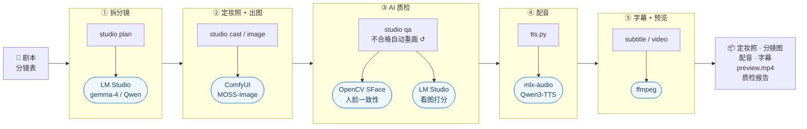
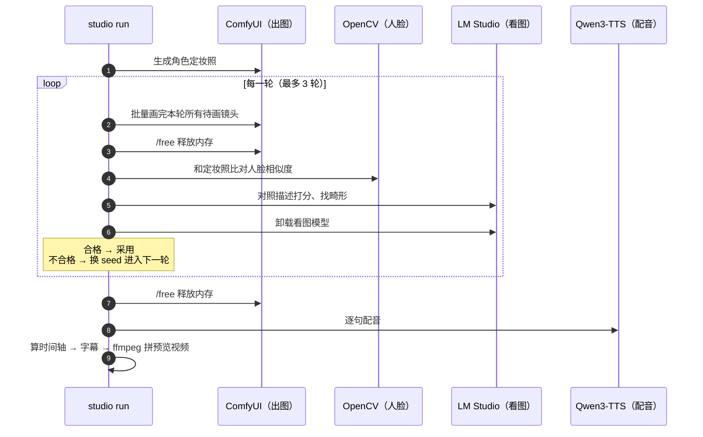

# ai-tools · 本地 AI 短剧工作台

一台 MacBook Pro（M5 Pro / 24G），全本地、零 API 费用，把**剧本**变成**分镜图 + 配音 + 字幕 + 预览视频**，并用 AI 自动质检保证角色前后一致。

## 演示

<p align="center">
  
</p>


> 上面是示例剧本《雨夜》跑一遍流水线的产出：4 个镜头，图片、配音、字幕全部由本地模型生成，ffmpeg 自动拼成预览视频。
> 带声音的完整预览：[docs/assets/preview.mp4](docs/assets/preview.mp4)

**实测耗时**（MacBook Pro M5 Pro / 24G）

| 步骤 | 引擎 | 耗时 |
|---|---|---|
| 出图（768×1344） | ComfyUI + FLUX.2 klein 4B（4 步） | ≈ 1 分钟 / 张（MOSS-Image 25 步 ≈ 3.9 分钟） |
| 配音 | mlx-audio + Qwen3-TTS 1.7B | ≈ 8.5 秒 / 句（首句含加载 19 秒） |
| 字幕 + 预览视频 | 自研时间轴 + ffmpeg | 几秒 |

## 架构



**设计思路：专用引擎 + 统一编排**

- 每类模型交给最擅长的引擎：语言模型用 LM Studio（MLX / llama.cpp，生成文本快），扩散模型用 ComfyUI（节点化出图），配音用 mlx-audio。
  反例：同样 9B 的语言模型放在 ComfyUI 里跑（GPTQ 量化，在 Mac 上没有加速），8 分钟只走了 2%。
- `studio` 是编排层：对外只有一个命令入口，负责任务调度、断点续跑（已有产物自动跳过）、失败重试和报告。
- **24G 内存调度**：几个大模型轮流使用，而不是同时常驻。



## 独立小工具

除了流水线，仓库里还有两个随手用的命令（定义在 `shell/aliases.zsh`）：

| 命令 | 引擎 | 用途 |
|---|---|---|
| `srt 视频.mp4` | mlx-whisper（whisper-large-v3-turbo） | 给**已有视频**自动出字幕：单行 ≤16 字、简体中文，批量 `srt *.mp4` |
| `tts "台词" -v Vivian -i "紧张"` | mlx-audio（Qwen3-TTS） | 单句配音，试音色和语气 |

> 为什么流水线里不用 Whisper？流水线的台词是已知的，字幕直接按"台词 + 配音时长"计算，比再识别一遍更准、更快；Whisper 用在没有文稿的现成视频上。

启用：
```bash
brew install ffmpeg uv
uv tool install mlx-whisper
echo 'source ~/ai-tools/shell/aliases.zsh' >> ~/.zshrc && source ~/.zshrc
```

## 目录结构

```
ai-tools/
├── README.md            ← 你在看的这个
├── config.toml          ← 所有配置：端口、模型、音色、字幕字数……
├── pyproject.toml       ← Python 依赖（用 uv 管理）
├── tts.py               ← tts 命令用的单句配音脚本
├── shell/aliases.zsh    ← srt / tts 快捷命令（mlx-whisper / Qwen3-TTS）
├── studio/              ← 流水线源码
│   ├── cli.py           ← 命令入口：check / image / plan / run
│   ├── pipeline.py      ← 流水线主流程
│   ├── comfy.py         ← ComfyUI API 客户端（出图）
│   ├── tts.py           ← 配音（Qwen3-TTS / mlx-audio）
│   ├── subtitle.py      ← 由台词 + 音频时长生成 SRT
│   ├── video.py         ← ffmpeg 拼预览视频
│   ├── plan.py          ← LM Studio：剧本 → 分镜表
│   ├── storyboard.py    ← 分镜表格式（角色 + 镜头）
│   ├── qa.py            ← AI 自动质检：定妆照、打分、重画、报告
│   ├── label.py         ← 人工标注页面（盲标"像不像"）
│   ├── calibrate.py     ← 人脸相似度阈值校准（人工标注 + 对照组 + 分布图）
│   ├── face.py          ← 人脸一致性（OpenCV YuNet + SFace）
│   ├── vision.py        ← 看图质检（LM Studio 多模态模型）
│   └── llm.py           ← OpenAI 兼容客户端（plan / vision 共用）
├── workflows/           ← ComfyUI 工作流（API 格式）
├── screenplays/         ← 剧本（纯文本）
├── storyboards/         ← 分镜表（JSON）
├── models/              ← 人脸模型（首次运行自动下载，不进 git）
├── output/              ← 生成结果，每个项目一个文件夹（不进 git）
└── docs/
    ├── assets/          ← README 用的演示 GIF / 分镜总览图 / 预览视频
    ├── toolbox.md       ← 各工具速查：LM Studio / ComfyUI / srt / tts
    ├── roadmap.md       ← 后续学习和扩展路线
    └── learning-log.md  ← 学习日志
```

## 第一次使用

```bash
cd ~/ai-tools
uv sync                 # 安装依赖（第一次要几分钟）
uv run studio check     # 检查环境
```

## 日常用法

```bash
# 1. 快速试一张图（调提示词用）
uv run studio image "Cinematic vertical film still of ..."

# 2. 跑示例：4 个镜头 → 定妆照、图片（带质检）、配音、字幕、预览视频
uv run studio run storyboards/example.json

#    只看质检、不重画（比如想知道旧图的一致性分数）
uv run studio qa storyboards/example.json

# 3. 用自己的剧本：先让 LM Studio 拆分镜（要先打开 LM Studio 的 Server 并加载模型）
uv run studio plan screenplays/example.txt
#    打开 storyboards/example.json 检查修改，然后卸载 LM Studio 模型，再：
uv run studio run storyboards/example.json
```

结果在 `output/<标题>/`：

| 文件 | 说明 |
|---|---|
| `images/01.png …` | 每个镜头的分镜图 |
| `audio/01.wav …` | 每句台词的配音 |
| `subtitles.srt` | 字幕（每条 ≤16 字，可在 config.toml 调） |
| `preview.mp4` | 图片 + 配音 + 软字幕的预览视频，看节奏用 |
| `timeline.json` | 每个镜头的起止时间 |
| `cast/linxia.png` | 角色定妆照（人脸比对的"标准脸"） |
| `qa_report.md` / `qa.json` | 质检报告：每个镜头画了几次、人脸相似度、画面分、瑕疵 |
| `images/_candidates/` | 每一轮的候选图，方便对比 |

**改一个镜头**：删掉对应的 `images/03.png` 或 `audio/03.wav`，再 `run` 一次，只会重新生成缺的文件。
**只跑某一步**：`uv run studio run storyboards/xxx.json --only audio`
**全部重来**：加 `--force`

## AI 自动质检

```
出图 ──▶ 人脸比对（和定妆照像不像）──▶ 看图模型打分（符不符合描述、有没有畸形）
  ▲                                                │
  └──────── 不合格：换 seed 重画（最多 3 次）◀──────┘
```

- **角色**：分镜表里定义 `characters`，镜头描述里写 `{linxia}`，会自动替换成统一的外貌描述
- **参考图生成**（FLUX.2 klein 4B）：有角色的镜头把定妆照喂给模型，照着这张脸画，而不是只靠文字描述去"抽卡"
- **定妆照**：每个角色自动生成正脸 + 左右 3/4 侧脸三张，也可以用 `ref` 指定自己挑的图；`uv run studio cast` 可以单独重画
- **人脸一致性**：OpenCV SFace 算余弦相似度，≥ `face_threshold` 算同一个人。参照取"定妆照三个角度 + 本集已通过的镜头"里最像的一个，
  避免中景、侧脸镜头被正脸定妆照误判；报告里记录每张脸的大小和转向，方便分析景别对分数的影响
- **画面质检**：LM Studio 里的 gemma-4 看图，对照描述打 1~5 分并列出瑕疵；LM Studio 没开就自动跳过
- **内存调度**：每一轮先让 ComfyUI 把图都画完 → 释放 → 再加载看图模型质检 → 卸载，避免几个大模型同时挤 24G
- 不想质检：`uv run studio run ... --no-qa`
- **阈值校准**（官方 0.363 是在真人照片上测的，AI 生成的脸要自己测）：
  1. `uv run studio label storyboards/example.json`：浏览器里盲标"两张图像不像同一个角色"，作为正确答案
  2. `uv run studio calibrate storyboards/example.json`：再生成一组"不同的人"作对照组，输出分布图、建议阈值，
     以及"自动判断和人工判断的一致率"（`output/_calibrate/calibration.md`）

## 注意内存（24G）

三个大模型不要同时开：**LM Studio 拆完分镜就卸载模型**；流水线出完图会自动让 ComfyUI 释放内存，再开始配音。

## 换出图模型

1. 在 ComfyUI 里调好新的工作流（比如 Z-Image Turbo），菜单 工作流 → 导出(API)，放进 `workflows/`
2. 打开这个 json，找到提示词、seed、保存图像这几个节点的编号，改 `config.toml` 的 `[comfy]` 部分
3. `uv run studio check` 确认节点都找得到
