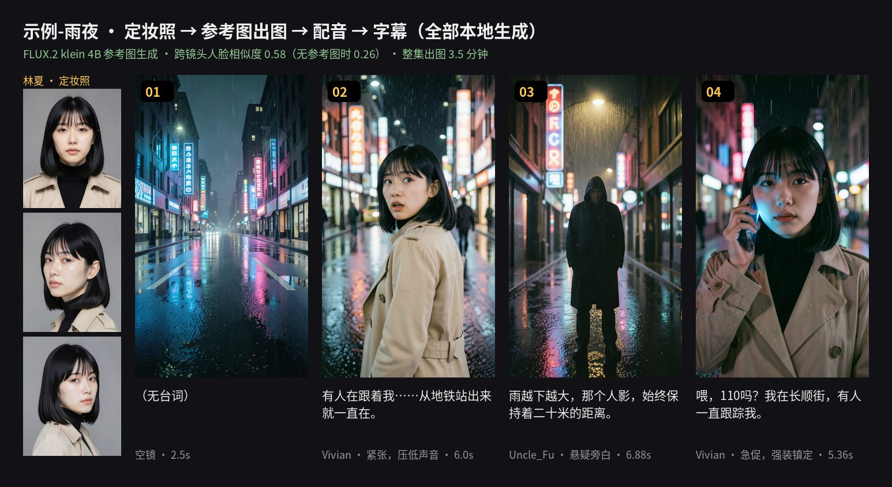
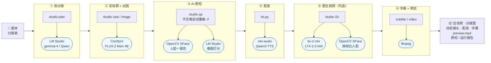
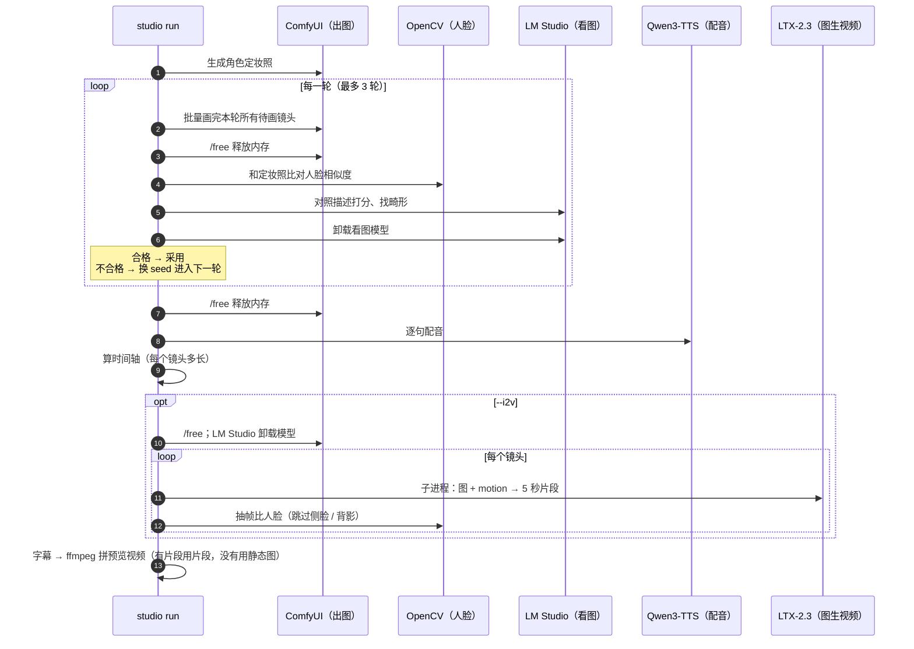

# ai-tools · 本地 AI 短剧工作台

一台 MacBook Pro（M5 Pro / 24G），全本地、零 API 费用，把**剧本**变成**分镜图 + 动态镜头 + 配音 + 字幕 + 预览视频**，并用 AI 自动质检保证角色前后一致（动起来以后也检查）。

## 演示

<p align="center">
  
</p>



> 示例剧本《雨夜》跑一遍流水线的产出：先生成角色的三角度定妆照，有角色的镜头照着定妆照画（FLUX.2 klein 参考图生成），
> 每个镜头再由 LTX-2.3（MLX 本地运行）按 `motion` 动作描述生成 5 秒动态镜头，
> 配音、字幕全部由本地模型生成，ffmpeg 自动拼成预览视频。带声音的完整预览：[docs/assets/preview.mp4](docs/assets/preview.mp4)
> （加图生视频之前的静态版：[demo-v4-static.gif](docs/assets/demo-v4-static.gif)）

**实测**（MacBook Pro M5 Pro / 24G）

| 步骤 | 引擎 | 耗时 |
|---|---|---|
| 出图（768×1344） | ComfyUI + FLUX.2 klein 4B（4 步，参考图编辑） | ≈ 40~60 秒 / 张 |
| 图生视频（448×768，5 秒） | ltx-2-mlx + LTX-2.3 int4（蒸馏版，float16 计算） | ≈ 72 秒 / 段，峰值显存 11 GB |
| 图生视频（576×1024，5 秒） | 同上 | ≈ 128 秒 / 段，峰值显存 11.7 GB |
| 配音 | mlx-audio + Qwen3-TTS 1.7B | ≈ 8.5 秒 / 句（首句含加载 19 秒） |
| 字幕 + 预览视频 | 自研时间轴 + ffmpeg | 几秒 |

**角色一致性的演进**（同一角色两个镜头的人脸相似度，SFace；不同的人 95% 低于 0.45）

| 版本 | 做法 | 跨镜头相似度 | 整集出图 |
|---|---|---|---|
| v1 | MOSS-Image 文生图，靠文字描述外貌 | 0.26 | 16 分钟 |
| v2 | + AI 质检，不合格换 seed 重画（最多 3 次） | 0.44 | 31 分钟 |
| v3 | FLUX.2 klein 参考图生成（MOSS 定妆照） | 0.41 | 12.5 分钟 |
| **v4** | **klein 定妆照（正脸 + 左右侧脸）+ klein 全流程** | **0.58** | **3.5 分钟** |

关键结论（详见 [学习日志](docs/learning-log.md)）：换 seed 抽卡"能挑不能造"；参考图生成才能真正锁住长相；
定妆照和剧照由同一个模型生成，风格统一后分数整体上升。人工标注显示常规镜头一致性 100% 获认可，大笑、怒吼等极端表情仍会"换脸"。

**动起来以后脸会不会变**（v5：图生视频；每 6 帧抽 1 帧和定妆照比，只统计正脸 / 半侧脸的帧）

| 镜头 | 分辨率 | 人脸最低 ~ 中位 | 说明 |
|---|---|---|---|
| 04 打电话（近景） | 448×768 | 0.59 ~ 0.63 | 不低于原图本身（0.62），没有"越动越不像" |
| 02 回头（中景） | 448×768 | 0.35 ~ 0.48 👀 | 脸只有约 60 像素 + 惊恐张嘴 |
| 02 回头（中景） | 576×1024 | **0.44** ~ 0.48 | 最低分回到阈值以上：低分辨率拖累的是最差的几帧 |

转头、背影时分数下降是正常的（2 秒测试片段最后一帧转到后脑勺，分数 0.08），所以视频质检按偏航角跳过这些帧，否则会误报。

## 架构



**设计思路：专用引擎 + 统一编排**

- 每类模型交给最擅长的引擎：语言模型用 LM Studio（MLX / llama.cpp，生成文本快），扩散模型用 ComfyUI（节点化出图），配音用 mlx-audio。
  反例：同样 9B 的语言模型放在 ComfyUI 里跑（GPTQ 量化，在 Mac 上没有加速），8 分钟只走了 2%。
- `studio` 是编排层：对外只有一个命令入口，负责任务调度、断点续跑（已有产物自动跳过）、失败重试和报告。
- **24G 内存调度**：几个大模型轮流使用，而不是同时常驻。
- **重量级引擎用子进程隔离**：图生视频引擎（ltx-2-mlx）装在独立目录、独立 uv 环境，`studio` 用子进程调用。
  它依赖的 mlx 版本不会和配音的 mlx-audio 冲突；进程结束显存全部归还；以后换 Wan 2.2 等引擎，只需要实现同样的 `generate()` 接口。



## 独立小工具

除了流水线，仓库里还有两个随手用的命令（定义在 `shell/aliases.zsh`）：

| 命令 | 引擎 | 用途 |
|---|---|---|
| `srt 视频.mp4` | mlx-whisper（whisper-large-v3-turbo） | 给**已有视频**自动出字幕：单行 ≤16 字、简体中文，批量 `srt *.mp4` |
| `tts "台词" -v Vivian -i "紧张"` | mlx-audio（Qwen3-TTS） | 单句配音，试音色和语气 |

> 为什么流水线里不用 Whisper？流水线的台词是已知的，字幕直接按"台词 + 配音时长"计算，比再识别一遍更准、更快；Whisper 用在没有文稿的现成视频上。

启用：
```bash
brew install ffmpeg uv
uv tool install mlx-whisper
echo 'source ~/ai-tools/shell/aliases.zsh' >> ~/.zshrc && source ~/.zshrc
```

## 目录结构

```
ai-tools/
├── README.md            ← 你在看的这个
├── config.toml          ← 所有配置：端口、模型、音色、字幕字数……
├── pyproject.toml       ← Python 依赖（用 uv 管理）
├── tts.py               ← tts 命令用的单句配音脚本
├── shell/aliases.zsh    ← srt / tts 快捷命令（mlx-whisper / Qwen3-TTS）
├── studio/              ← 流水线源码
│   ├── cli.py           ← 命令入口：check / image / plan / run / i2v / qa / runs ……
│   ├── pipeline.py      ← 流水线主流程
│   ├── comfy.py         ← ComfyUI API 客户端（出图）
│   ├── tts.py           ← 配音（Qwen3-TTS / mlx-audio）
│   ├── subtitle.py      ← 由台词 + 音频时长生成 SRT
│   ├── i2v.py           ← 图生视频：LTX-2.3（子进程调用）+ 抽帧人脸质检
│   ├── checks.py        ← 环境检查（studio check 和网页共用）
│   ├── mcp_server.py    ← MCP Server：让 Claude 等 Agent 通过 studio web 的接口操作流水线
│   ├── web/             ← 网页控制台后端：app.py（接口）、jobs.py（任务队列 + SSE）、projects.py（项目数据）、static/（构建好的前端）
│   ├── video.py         ← ffmpeg 拼预览视频
│   ├── plan.py          ← LM Studio：剧本 → 分镜表
│   ├── storyboard.py    ← 分镜表格式（角色 + 镜头）
│   ├── qa.py            ← AI 自动质检：定妆照、打分、重画、报告
│   ├── label.py         ← 人工标注页面（盲标"像不像"）
│   ├── calibrate.py     ← 人脸相似度阈值校准（人工标注 + 对照组 + 分布图）
│   ├── samples.py       ← 收集角色的所有图（标注、校准共用）
│   ├── metrics.py       ← 可观测性：耗时记录、运行报告、历史对比
│   ├── face.py          ← 人脸一致性（OpenCV YuNet + SFace）
│   ├── vision.py        ← 看图质检（LM Studio 多模态模型）
│   └── llm.py           ← OpenAI 兼容客户端（plan / vision 共用）
├── web/                 ← 网页控制台前端源码（React + TypeScript，npm run build → studio/web/static/）
├── workflows/           ← ComfyUI 工作流（API 格式）
├── screenplays/         ← 剧本（纯文本）
├── storyboards/         ← 分镜表（JSON）
├── models/              ← 人脸模型（首次运行自动下载，不进 git）
├── output/              ← 生成结果，每个项目一个文件夹（不进 git）
└── docs/
    ├── assets/          ← README 用的演示动图 / 分镜总览图 / 预览视频
    ├── knowledge-map.html ← 模型知识图谱：用到的神经网络、模型及所在阶段
    ├── toolbox.md       ← 各工具速查：LM Studio / ComfyUI / srt / tts
    ├── roadmap.md       ← 后续学习和扩展路线
    └── learning-log.md  ← 学习日志
```

## 第一次使用

```bash
cd ~/ai-tools
uv sync                 # 安装依赖（第一次要几分钟）
uv run studio check     # 检查环境
```

## 模型路由：本地优先、云端兜底

拆分镜（`studio plan`）和看图质检共用 `studio/llm.py`，网页操作也走这条路径。默认 `[lmstudio.cloud] enabled = false`，目前只有本地模型时无需改配置，也不会产生云端请求。

默认自动模式先请求本地；连接失败、超时、HTTP 错误、空输出、接口结构异常、无效 JSON 或结果不符合 schema 时，才尝试一次云端。两端都失败会报告各端失败原因；取消任务不会触发兜底。云端文本和图片分别选择 `model`、`vision_model`，不会沿用本地模型名。人脸比对、出图、配音和图生视频仍按原有流程执行。

网页顶部的「模型调用」提供三档：

| 模式 | 行为 |
|---|---|
| 仅本地 | 只调用 LM Studio，失败不使用云端 |
| 仅云端 | 直接调用已配置的云端，失败不回退本地 |
| 本地优先、云端兜底 | 先本地，失败后尝试云端 |

选择保存到 `output/_web/model-routing.json`，刷新或重启保留，不修改 `config.toml`。每个新任务在提交时记录模式，已排队和运行中的任务不会因后续切换改变。只影响拆分镜和看图质检，出图、视频和配音引擎不变。顶部可展开查看云端文本/看图配置状态，云端均未就绪时「仅云端」不可选。

显式选择「仅云端」或「自动兜底」允许新任务使用已配置的云端，即使配置文件中的 `enabled = false`；选择「仅本地」则禁止这些任务使用云端。首次没有网页选择记录时，根据 `enabled` 决定默认模式（关闭则仅本地，开启则自动）。CLI 未指定模式时沿用原有配置；也可显式指定：

```bash
uv run studio --llm-mode local plan screenplays/example.txt
uv run studio --llm-mode cloud plan screenplays/example.txt
uv run studio --llm-mode auto qa storyboards/example.json
```

`api_key_env` 填的是环境变量**名称**（如 `STUDIO_CLOUD_API_KEY`），不是密钥本身。页面会提示这种配置错误并隐藏无效值；不要把密钥写入此字段。环境变量需要在启动网页服务的终端中设置。切换页面模式不替代密钥配置。

需要云端时，编辑 `config.toml` 已有的配置段（替换示例地址、模型 ID）：

```toml
[lmstudio.cloud]
enabled = true
url = "https://your-provider.example/v1"
model = "your-text-model-id"
vision_model = "your-vision-model-id"  # 不用云端看图则留空
api_key_env = "STUDIO_CLOUD_API_KEY"
timeout_sec = 120
```

密钥通过环境变量传入，随后在同一终端启动 CLI 或网页服务：

```bash
export STUDIO_CLOUD_API_KEY="你的密钥"
uv run studio check
uv run studio web
```

云端服务和模型需支持 OpenAI 兼容的 `/chat/completions`、`temperature` 和 `response_format=json_schema` 严格输出；云端看图模型还需支持 `image_url`（base64 图片）。不支持这些参数的服务不能直接用此配置。严格 schema 依据 [OpenAI 官方结构化输出文档](https://developers.openai.com/api/docs/guides/structured-outputs)。

- 启用兜底表示本地失败时会把同一份剧本或质检图片发送给所配置的云端，可能计费。
- `studio check` 展示云端是否启用、模型/密钥是否配置完整，不向云端发请求，也不代表真实云端已联通。
- 本地默认超时 600 秒，看图调用上限 300 秒；可在 `[lmstudio] timeout_sec` 调小以更快兜底。云端默认上限 120 秒，调用方更短的上限仍生效。
- 云端未启用或配置不完整时，本地成功仍正常返回；本地也不可用时，拆分镜报错，看图质检保留原有降级跳过行为。
- 日志在任务开始时标出路由策略；每次实际调用记录本地/云端、文本/看图、模型名、开始/成功/失败和耗时，自动兜底记录切换过程。未发起请求明确显示“模型未调用”；出图单独显示 ComfyUI 来源和工作流。不打印密钥、剧本、图片或接口响应正文。

运行离线回归测试：`uv run python -m unittest discover -v`。当前通过模拟 HTTP 边界验证路由；尚未用真实云端账号联调。

## 网页控制台

```bash
uv sync                  # 第一次：装上 starlette / uvicorn
uv run studio web        # 打开 http://127.0.0.1:8780
```

不用记命令，在浏览器里走完整个流程：

| 页面 | 能做什么 |
|---|---|
| 总览 | 环境检查（ComfyUI / LM Studio / 图生视频引擎 / 人脸模型 / 配音），最近的任务和运行耗时 |
| 剧本 | 粘贴故事 → 用本地模型拆成分镜表 |
| 项目 · 镜头墙 | 每个镜头的图、候选图、动态片段、配音、人脸分数和画面分，👀 标出要人工看的；单个镜头重画图 / 重新配音 / 换种子重做视频 |
| 项目 · 生成 | 一键跑全流程或单独跑某一步，日志实时滚动，可以取消 |
| 项目 · 编辑分镜 | 表单编辑角色和镜头（画面、动作、台词、音色），保存时按命令行同一套规则校验；也能直接改 JSON |
| 项目 · 定妆照 / 预览视频 / 报告 | 三角度定妆照；带字幕的预览视频和时间线；每次运行的报告和耗时图、质检报告 |
| 项目 · 人工标注 | 盲标"像不像同一个人"（键盘 1/2/3），给阈值校准用 |
| 任务 / 运行历史 / 阈值校准 / 试一张图 | 任务队列和日志；所有运行的阶段耗时对比；校准结果表；单独试提示词 |

**实现**

- 后端（`studio/web/`，Starlette）：网页上的每个操作都翻译成一条 `studio` 命令（白名单拼参数），放进**单 worker 任务队列**在子进程里执行 ——
  和命令行走同一条代码路径；24GB 内存一次只能跑一个大模型，所以串行排队；子进程结束，模型内存全部释放
- 日志用 **SSE** 推给页面（断线带 `?from=N` 续传）；取消是给整个进程组发 SIGINT，和按 Ctrl+C 一样收尾，已生成的文件和运行报告都保留
- 重做某个镜头时旧文件挪进 `_history/<时间>/`，不删除；视频片段重做会换随机种子（同一张图 + 同一段描述，只有换种子才出不同的动作）
- 前端（`web/`，React + TypeScript，esbuild 打包）：构建产物提交在 `studio/web/static/`，**用控制台不需要装 Node**；
  改前端时 `cd web && npm install && npm run dev`（监听构建，刷新浏览器即可）

## MCP：让 Agent 直接操作流水线

`studio/mcp_server.py` 把控制台的能力包装成 MCP 工具，Claude Code / Claude Desktop 等客户端可以直接读分镜、改分镜、提交任务、看成图。

```bash
uv run studio web --no-browser   # 先开控制台（MCP 只是它的客户端）
claude mcp add ai-tools -- uv --directory ~/ai-tools run python -m studio.mcp_server
```

Claude Desktop 在 `claude_desktop_config.json` 里加同样的 `command` / `args` 即可。控制台不在默认地址时，设环境变量 `STUDIO_URL`。

| 工具 | 作用 |
|---|---|
| `check_env` / `list_storyboards` / `get_storyboard` / `get_project` | 只读：环境检查、分镜表列表和完成度、分镜原文、每个镜头的产物和质检分数 |
| `view_shot_image` | 返回某个镜头的成图（缩到 512px），让模型自己看构图和人物 |
| `save_storyboard` | 整份保存分镜表，和命令行同一套校验，不合法不覆盖 |
| `start_job` / `redo_shot` | 提交全流程、单步、图生视频、定妆照、质检、拆分镜、试图；重做单个镜头（旧文件归档） |
| `get_job` / `wait_job` / `cancel_job` | 查进度和日志尾部；等待结果（单次最多 50 秒，没完成就再调）；取消 |

**设计取舍**

- **只做 HTTP 薄客户端，不自己跑任务**：24GB 内存一次只能跑一个大模型，任务队列只能有一个主人。MCP 提交的任务和网页上点的排在同一个队列里，网页上能看到、能取消。
- **长任务异步**：出图、图生视频要几分钟，超过 MCP 调用超时。`start_job` 立即返回任务 ID 和前面还排着几个，`wait_job` 期间上报进度。
- **白名单**：任务参数走和网页同一个 `build_job` 校验，不提供"执行任意命令"；工具带只读 / 会覆盖的标注，客户端可以据此决定要不要确认。

## 日常用法

```bash
# 1. 快速试一张图（调提示词用）
uv run studio image "Cinematic vertical film still of ..."

# 2. 跑示例：4 个镜头 → 定妆照、图片（带质检）、配音、字幕、预览视频
uv run studio run storyboards/example.json

#    只看质检、不重画（比如想知道旧图的一致性分数）
uv run studio qa storyboards/example.json

# 3. 用自己的剧本：先让 LM Studio 拆分镜（要先打开 LM Studio 的 Server 并加载模型）
uv run studio plan screenplays/example.txt
#    打开 storyboards/example.json 检查修改，然后卸载 LM Studio 模型，再：
uv run studio run storyboards/example.json

# 4. 图生视频：每个镜头的图 → 动态镜头，然后自动重拼预览视频（图和配音要先有）
uv run studio i2v storyboards/example.json              # 全部镜头（已有片段跳过）
uv run studio i2v storyboards/example.json --shots 2,4 --force   # 只重做某几个
uv run studio run storyboards/example.json --i2v        # 或者整条流水线一起跑
```

**图生视频引擎**（一次性安装，约 30GB 下载）：
```bash
mkdir -p ~/ai-engines && cd ~/ai-engines
git clone https://github.com/dgrauet/ltx-2-mlx.git && cd ltx-2-mlx && uv sync
```
分镜表里每个镜头写 `motion`（英文动作描述，例如 `"{linxia} slowly turns her head and glances back, camera pushes in"`），
`studio plan` 拆分镜时会一起写。定位是"动态分镜"：本地快速看动作和节奏，定稿镜头再交给可灵 / 即梦。

结果在 `output/<标题>/`：

| 文件 | 说明 |
|---|---|
| `images/01.png …` | 每个镜头的分镜图 |
| `audio/01.wav …` | 每句台词的配音 |
| `subtitles.srt` | 字幕（每条 ≤16 字，可在 config.toml 调） |
| `clips/01.mp4 …` | 图生视频片段（`studio i2v`），同名 `.log` 是引擎日志 |
| `preview.mp4` | 动态片段（没有就用图片）+ 配音 + 软字幕的预览视频，看节奏用 |
| `timeline.json` | 每个镜头的起止时间 |
| `cast/linxia.png` | 角色定妆照（人脸比对的"标准脸"） |
| `qa_report.md` / `qa.json` | 质检报告：每个镜头画了几次、人脸相似度、画面分、瑕疵 |
| `images/_candidates/` | 每一轮的候选图，方便对比 |

**改一个镜头**：删掉对应的 `images/03.png` 或 `audio/03.wav`，再 `run` 一次，只会重新生成缺的文件。
**只跑某一步**：`uv run studio run storyboards/xxx.json --only audio`
**全部重来**：加 `--force`

## AI 自动质检

```
出图 ──▶ 人脸比对（和定妆照像不像）──▶ 看图模型打分（符不符合描述、有没有畸形）
  ▲                                                │
  └──────── 不合格：换 seed 重画（最多 3 次）◀──────┘
```

- **角色**：分镜表里定义 `characters`，镜头描述里写 `{linxia}`，会自动替换成统一的外貌描述
- **参考图生成**（FLUX.2 klein 4B）：有角色的镜头把定妆照喂给模型，照着这张脸画，而不是只靠文字描述去"抽卡"
- **定妆照**：每个角色自动生成正脸 + 左右 3/4 侧脸三张，也可以用 `ref` 指定自己挑的图；`uv run studio cast` 可以单独重画
- **人脸一致性**：OpenCV SFace 算余弦相似度，≥ `face_threshold` 算同一个人。参照取"定妆照三个角度 + 本集已通过的镜头"里最像的一个，
  避免中景、侧脸镜头被正脸定妆照误判；报告里记录每张脸的大小和转向，方便分析景别对分数的影响
- **画面质检**：LM Studio 里的 gemma-4 看图，对照描述打 1~5 分并列出瑕疵；表情夸张（大笑闭眼、张嘴怒吼）的镜头标 👀 提醒人工复核；LM Studio 没开就自动跳过
- **内存调度**：每一轮先让 ComfyUI 把图都画完 → 释放 → 再加载看图模型质检 → 卸载，避免几个大模型同时挤 24G
- 不想质检：`uv run studio run ... --no-qa`
- **阈值校准**（官方 0.363 是在真人照片上测的，AI 生成的脸要自己测）：
  0. `uv run studio run storyboards/calibration.json --only images --no-qa`：校准专用分镜表，同一角色 8 种景别/表情，关掉质检拿到未筛选的样本
  1. `uv run studio label storyboards/calibration.json`：浏览器里盲标"两张图像不像同一个角色"，作为正确答案（标注带内容指纹，图重画后旧标注自动失效）
  2. `uv run studio calibrate storyboards/calibration.json`：再生成一组"不同的人"作对照组，输出分布图、建议阈值，
     以及"自动判断和人工判断的一致率"（`output/_calibrate/calibration.md`）

## 可观测性：每次运行自动出报告

每次 `studio run` 都会记录各阶段耗时、每张图 / 每句配音的耗时、重画次数和质检结果（失败也会记录）：

- `output/<项目>/runs/<时间>/report.md`：总耗时和各阶段占比、最慢的 5 步、质检通过率、配音实时率、
  图生视频的"生成 1 秒视频要几秒"和峰值显存，以及**和同一条命令上一次运行的对比**
- `output/<项目>/runs/<时间>/metrics.json`：原始数据
- `output/runs.csv`：所有运行的历史（含 git 版本、所用模型），`uv run studio runs` 在终端里查看

改了模型、参数或代码之后再跑一次，就能用数据看到是快了还是慢了。

## 注意内存（24G）

三个大模型不要同时开：**LM Studio 拆完分镜就卸载模型**；流水线出完图会自动让 ComfyUI 释放内存，再开始配音。
图生视频峰值约 11~13GB，开始前会自动让 ComfyUI、LM Studio 卸载模型。

## 换出图模型

1. 在 ComfyUI 里调好新的工作流（比如 Z-Image Turbo），菜单 工作流 → 导出(API)，放进 `workflows/`
2. 打开这个 json，找到提示词、seed、保存图像这几个节点的编号，改 `config.toml` 的 `[comfy]` 部分
3. `uv run studio check` 确认节点都找得到
